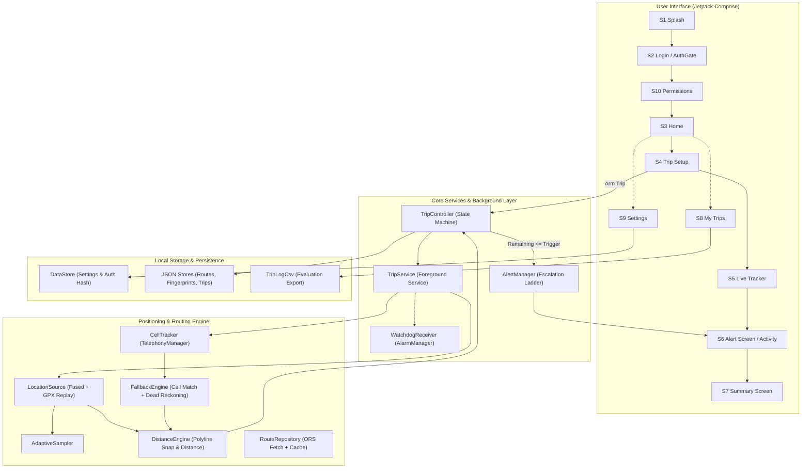

# Para Po! Implementation Plan & Build Workflow

This step-by-step workflow operationalizes the **CS 312 Final Project Proposal and Build Guide** for **Para Po! (Group 13)** into 7 sequential phases. It addresses all 17 Functional Requirements (FR-01 to FR-17), all 10 Screens (S1 to S10), core mathematical positioning logic, and the 13 verification test cases.

---

## Architecture & Module Dependency Graph



---

## Phase 1: Manifest, Permissions & Guided Wizard (FR-05, FR-14, Screen S10)

> [!IMPORTANT]
> Modern Android versions require specific manifest attributes and user grants for location-based foreground services and lock-screen alerts.

- [x] **1.1 Update `AndroidManifest.xml`**:
  - Add required permissions:
    ```xml
    <uses-permission android:name="android.permission.ACCESS_FINE_LOCATION" />
    <uses-permission android:name="android.permission.ACCESS_COARSE_LOCATION" />
    <uses-permission android:name="android.permission.ACCESS_BACKGROUND_LOCATION" />
    <uses-permission android:name="android.permission.FOREGROUND_SERVICE" />
    <uses-permission android:name="android.permission.FOREGROUND_SERVICE_LOCATION" />
    <uses-permission android:name="android.permission.POST_NOTIFICATIONS" />
    <uses-permission android:name="android.permission.USE_FULL_SCREEN_INTENT" />
    <uses-permission android:name="android.permission.SCHEDULE_EXACT_ALARM" />
    <uses-permission android:name="android.permission.REQUEST_IGNORE_BATTERY_OPTIMIZATIONS" />
    <uses-permission android:name="android.permission.SEND_SMS" />
    ```
  - Declare `<service android:name=".trip.TripService" android:foregroundServiceType="location" android:exported="false" />`.
  - Declare `<activity android:name=".alert.AlertActivity" android:showOnLockScreen="true" android:turnScreenOn="true" android:exported="false" />`.
  - Declare `<receiver android:name=".watchdog.WatchdogReceiver" android:exported="false" />`.

- [x] **1.2 Build `ui/PermissionsScreen.kt` (S10)**:
  - Step-by-step checklist wizard with Sulo mascot:
    1. **Precise Location** (`ACCESS_FINE_LOCATION`).
    2. **Background Location** ("Allow all the time", required for screen-off tracking).
    3. **Notifications & Full-Screen Alerts** (`POST_NOTIFICATIONS` + `USE_FULL_SCREEN_INTENT`).
    4. **Battery Unrestricted** (`Settings.ACTION_REQUEST_IGNORE_BATTERY_OPTIMIZATIONS`).
  - Block progression until required permissions are granted.

---

## Phase 2: Local Storage & AuthGate (FR-01, FR-15, FR-16, Screens S1, S2, S8, S9)

- [x] **2.1 Implement `auth/AuthGate.kt`**:
  - Standard PBKDF2-HMAC-SHA256 hasher (120,000 iterations, 16-byte cryptographically secure salt).
  - First-time PIN setup vs login verification.
  - "Forgot PIN?" flow: confirmation dialog that securely wipes local trip data and resets the credentials.
- [x] **2.2 Implement `storage/` Modules**:
  - `storage/SettingsStore.kt`: Preferences DataStore for user settings (default alert distance 3000 m, safety margin 500 m, sound delay 10 s, full-screen delay 20 s, SMS toggle/number).
  - `storage/RouteStore.kt`: Saves downloaded ORS route polylines to `routes/<routeId>.json`.
  - `storage/TripLogStore.kt` & `storage/TripLogCsv.kt`: Logs completed trips to `trips.json` and exports to CSV format with columns:
    `tripId, startedAt, mode, triggerM, firedAtRemainingM, errorM, source, gpsLostS, batteryStartPct, batteryEndPct`.
- [x] **2.3 Wire Screens S1, S2, S8, S9**:
  - `SplashScreen.kt` (S1): Checks if PIN is configured; navigates to S10 (first launch) or S2 (returning).
  - `LoginScreen.kt` (S2): Keypad connected to `AuthGate.verify()`.
  - `TripsScreen.kt` (S8): Displays past trips with "On time" / "Late" badges and an "Export CSV" button.
  - `SettingsScreen.kt` (S9): Sliders and toggles for tunable parameters with warning dialogs if sound or full-screen alerts are turned off.

---

## Phase 3: Location Tracking & Distance Calculation (FR-06, FR-07, FR-08, FR-09)

- [x] **3.1 Build `location/LocationSource.kt`**:
  - Encapsulate `FusedLocationProviderClient`.
  - Add **GPX Replay / Mock Engine**: Allows feeding synthetic location points from GPX files directly into the stream for automated testing without field driving.
- [x] **3.2 Implement `location/AdaptiveSampler.kt`**:
  - Adjust sampling rate to preserve battery (FR-06):
    - **Far** ($\text{remaining} > 2 \times \text{trigger}$): interval 5–10 s, balanced power.
    - **Near** ($\text{remaining} \le 2 \times \text{trigger}$): interval 1–2 s, high accuracy.
- [x] **3.3 Upgrade `distance/DistanceEngine.kt`**:
  - Ensure monotonic route progression:
    $$\text{progress} = \max(\text{bestProgress}, \text{lastProgress} - 50\text{ m})$$
  - Calculate remaining route distance from cached polyline:
    $$\text{remaining} = (\text{lengthM} - \text{progress}) \times \text{scale}$$
  - Offline straight-line fallback with road factor ($1.25\times$) when no cached route exists (FR-08).
  - Smooth GPS speed using Exponential Moving Average (EMA, $\alpha = 0.3$):
    $$v_{\text{smooth}} = 0.3 \times v_{\text{current}} + 0.7 \times v_{\text{prev}}$$
  - Speed-adaptive trigger distance:
    $$\text{trigger} = \operatorname{clamp}(v_{\text{smooth}} \times \text{leadTime}, 1000\text{ m}, \text{alertDistanceM})$$
    Add safety margin ($+500\text{ m}$) if position source is not GPS.

---

## Phase 4: Cellular & Sensor Fallback Engine (FR-10, FR-11, FR-12)

- [x] **4.1 Implement `cell/CellTracker.kt`**:
  - Read serving cell using `TelephonyManager.requestCellInfoUpdate()` (API 29+).
  - Extract unique `cellKey`: `"MCC-MNC-AreaCode-CellID-Tech"` (e.g. `515-02-4021-18274931-LTE`).
  - Extract signal strength (RSSI / RSRP).
- [x] **4.2 Implement `cell/FingerprintStore.kt` (R2 Learning)**:
  - While GPS fix is accurate ($\le 30\text{ m}$), record fingerprint at serving cell change or every 200 m progress.
  - Store mean, min, max progress, RSSI, and observation count to `fingerprints/<routeId>.json`.
- [x] **4.3 Implement `fallback/FallbackEngine.kt`**:
  - **GPS Loss Detection**: Triggered if no GPS fix with accuracy $\le 50\text{ m}$ within 10 seconds.
  - **Dead Reckoning along Route**:
    $$\text{dr} = \text{lastProgress} + v_{\text{last}} \times \Delta t$$
  - **Cell Fingerprint Matching**: Look up current cell in stored route fingerprints. Clamp match to a window around dead-reckoned progress to prevent jumping.
  - **Trust Limit & Confidence**: If GPS outage exceeds 180 seconds, mark status as "Low Confidence" and expand trigger distance by another $+500\text{ m}$ safety margin.

---

## Phase 5: Foreground TripService, Alert Escalation & Watchdog (FR-05, FR-13, FR-14, FR-17)

- [x] **5.1 Build `trip/TripService.kt`**:
  - Android `ForegroundService` with notification channel and persistent status bar notification.
  - Notification displays live remaining distance, ETA, and position source (`GPS`, `CELL`, or `DEAD RECKONING`).
  - Keeps tracking active when the device is locked and screen is turned off.
- [x] **5.2 Implement `alert/AlertManager.kt` Escalation Ladder (FR-13)**:
  - **$t = 0\text{ s}$**: Trigger vibration pattern (repeating every 3 seconds).
  - **$t = 10\text{ s}$**: Trigger alarm sound stream (`AudioManager.STREAM_ALARM`) at high volume.
  - **$t = 20\text{ s}$**: Launch full-screen intent (`AlertActivity`) over the lock screen.
  - Optional: Trigger SMS to emergency contact if enabled in settings (FR-17).
  - Alerts stop only when the user taps **"GISING NA AKO"** or cancels the trip.
- [x] **5.3 Implement `watchdog/WatchdogReceiver.kt` (FR-14)**:
  - Uses `AlarmManager.setExactAndAllowWhileIdle()` to schedule periodic watchdog pings.
  - Restores trip state and restarts `TripService` if killed by OEM aggressive battery managers.

---

## Phase 6: Screen Polish & Wiring (Screens S3, S4, S5, S6, S7)

- [x] **6.1 Fix Mockup Deviations (Part 6.6 & Part 8)**:
  - S3 Home: Replace Ethiopian demo data with Philippine locations and route cache chip.
  - S4 Trip Setup: Rename button to "Start Trip", vehicle mode selectors (Jeepney / Bus / Train) set lead times ($240\text{ s}$, $300\text{ s}$, $360\text{ s}$).
  - S5 Live Tracker: Display position source badge (`GPS` green, `Cell fallback` blue, `Dead reckoning` amber).
  - S6 Alert: Button text set to **"GISING NA AKO"**.
  - S7 Summary: Display arrival metrics (alert fired distance, GPS lost duration, fingerprints saved).
  - Mascot Poses: Wire Sulo calm, excited, arrived, and GPS-lost poses according to section 6.5.

---

## Phase 7: Verification & Test Plan (TC-01 to TC-13)

- [x] **7.1 Automated & GPX Scenario Testing**:
  - [x] **TC-01**: Normal straight route ($36\text{ km/h}$) $\to$ Alert within $\pm 300\text{ m}$ of 3 km.
  - [x] **TC-02**: Winding route $\to$ Verifies route distance is used, not straight-line.
  - [x] **TC-03**: Speed variation ($10\text{ km/h}$ vs $60\text{ km/h}$) $\to$ Trigger distance adapts.
  - [x] **TC-04**: GPS outage ($60\text{--}120\text{ s}$) with learned route $\to$ Cell matching fires alert within $\pm 500\text{ m}$.
  - [x] **TC-05**: GPS outage on first-time route $\to$ Dead reckoning takes over smoothly.
  - [x] **TC-06**: Outage $> 180\text{ s}$ $\to$ Confidence marked low, safety margin added.
  - [x] **TC-07**: Alert escalation ladder ($0\text{ s} \to 10\text{ s} \to 20\text{ s}$) continues until dismissed.
  - [x] **TC-08**: Screen-off adaptive 10 s sampling policy verified in JVM suite (physical 1-hour battery profiler drain $\le 5\%/\text{hour}$ to be logged during final CS 312 field run).
  - [x] **TC-09**: Moving away from destination $\to$ No false alert fired (`movingToward` check).
  - [x] **TC-10**: No internet & no cached route $\to$ Warning shown, straight-line $\times 1.25$ used.
  - [x] **TC-11**: Service killed mid-trip $\to$ Watchdog recovers state seamlessly.
  - [x] **TC-12**: Permissions denied/revoked $\to$ Wizard handles cleanly without crash.
  - [x] **TC-13**: Null or stale cell info $\to$ Falls back gracefully to dead reckoning.
